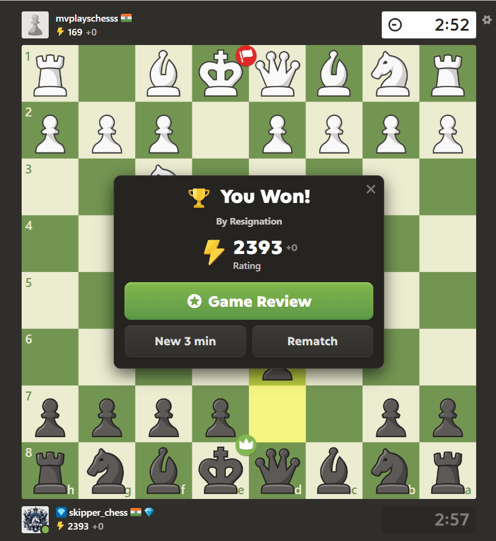
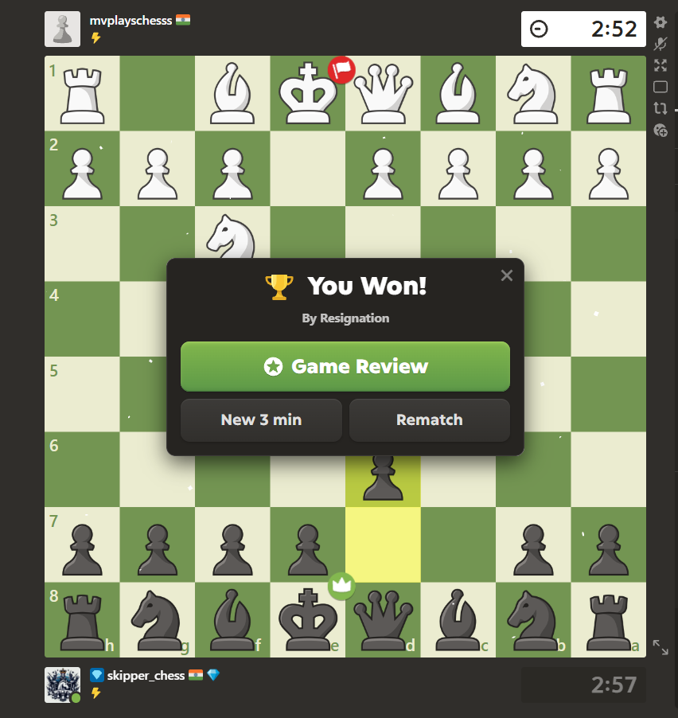

## ZenChess
ZenChess is a userscript that hides ratings on chess.com: yours and your opponent's, next to the names and in hover cards, as well as in the in-game popup. Ratings stay hidden until you turn it off.

| Before | After |
|---|---|
|  |  |

## Install

1. Install [Tampermonkey](https://www.tampermonkey.net/) or [Violentmonkey](https://violentmonkey.github.io/).
2. **Chrome / Edge only:** go to `chrome://extensions`, click Details on the manager and turn on **Allow user scripts**. If you skip this the script won't do anything. Older Chrome versions need Developer mode instead.
3. Open this link and click Install:
   https://raw.githubusercontent.com/dakshjain14/ZenChess/main/zenchess.user.js

## Use
- Start any game at https://www.chess.com/play/online (you need an account). Ratings next to both names are gone, and when the game ends the popup has no rating card.
- The Zen button can be toggled in the bottom right, or using Alt+Z.
- Mid-game, Alt+Z won't work. Hold the button for 3 seconds if you want to turn it off.
- For a session recap, click the Tampermonkey icon and pick **Set chess.com username**. When you turn Zen off it shows how much your rating changed while it was on.
